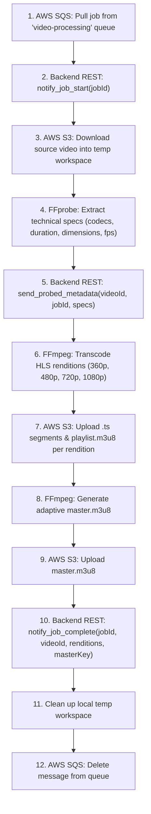

# Video Processing Worker (AWS SQS + FFmpeg + AWS S3 + Backend API)

A distributed Python FFmpeg video processing worker for the Video Platform backend. It has **zero direct database connections**, interacting strictly through:
1. **AWS SQS**: Consumes transcode tasks from the durable `video-processing` queue using long polling.
2. **AWS S3**: Downloads original uploaded videos, uploads HLS segments (`.ts`), playlists (`.m3u8`), and poster thumbnails (`.jpg`).
3. **NestJS Backend**: Reports all lifecycle state changes (`start`, `metadata`, `progress`, `complete`, `fail`) via secured HTTP REST endpoints using `WORKER_API_KEY`.

---

## Architecture Flow



---

## 1. Queue Configuration

| Setting | Value | Description |
|---|---|---|
| **Queue URL** | `https://sqs.eu-central-1.amazonaws.com/<your-account-id>/video-processing` | Durable AWS SQS Queue |
| **Wait Time** | `20s` | Long polling for real-time delivery with low API cost |
| **Visibility Timeout** | `7200s` | 2 hours reserved processing time per job |
| **Acknowledgment** | `sqs_client.delete_message` | Deleted upon completion or failure |

---

## 2. Running Locally

```bash
# Check connectivity to Backend API, AWS S3, and AWS SQS
python worker.py --check-services

# Start the worker daemon
python worker.py
```
